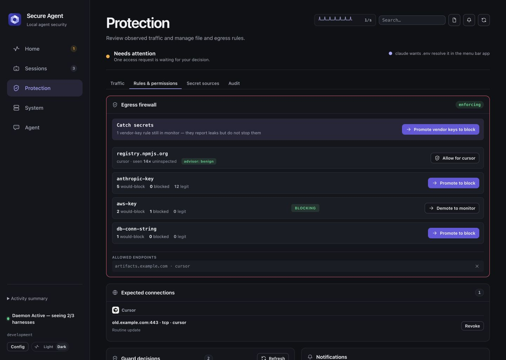

# Configure file and egress protection

[Documentation](README.md) · [Project home](../README.md)

[Getting started](GETTING_STARTED.md) installs the app and the selected hooks. Enable each protection deliberately: hook registration, named guard modes, secret fingerprints and proxy routing are separate controls.

- [Egress firewall and routing](#egress-secret-leak-firewall)
- [Review recurring connections](#review-recurring-connections)
- [Directory Guard and approvals](#directory-guard)
- [Configuration reference](CONFIGURATION.md)
- [Firewall limits](FIREWALL_THREAT_MODEL.md) · [Guard limits](GUARD_THREAT_MODEL.md)

## Egress secret-leak firewall

The firewall inspects routed outbound requests for secret exposure. Its opt-in HTTP/HTTPS proxy listens on `127.0.0.1:8443` by default. For inspected HTTPS hosts it generates certificates with Secure Agent's local CA, scans request streams for credentials, and scans response streams for prompt injection. Response headers are scanned as well: a header carrying an injection (the `X-AI` / `X-LLM` pattern) raises a **Prompt injection in a response** finding that names the header, and the header is removed before the agent reads the response. Enable routing and client CA trust explicitly; tunneled connections remain unopened.

<p align="center">
  
</p>

Screenshot uses synthetic demonstration data.

**Detection layers** (`daemon/internal/firewall/`):

- **Known-secret fingerprints** — your real secrets, stored only as a salted HMAC (never plaintext), matched even through base64 (any alphabet or padding), url, gzip, JSON, hex and decimal or `0x` byte-list encodings, such as a `.env` file written into source code as a list of numbers.
- **Canary credentials** — `secure-agent canary plant <file>` writes decoy AWS, GitHub, OpenAI, Anthropic and Stripe credentials to a new `0600` file and registers it as a fingerprint source. Nothing legitimate uses them, so a copy in inspected traffic or a transcript is a registered-secret finding. Place the file where an agent might look (a project's `.env.local`, for example); the command never overwrites a file.
- **Typed patterns** — Anthropic, OpenAI (incl. project keys), GitHub (classic + fine-grained), GitLab, AWS, Google, Stripe (secret/restricted/webhook), Slack, Twilio, SendGrid, npm, PyPI, DigitalOcean, Doppler, JWT, bearer tokens, private keys, and database connection strings with embedded credentials.
- **Entropy** — a high-entropy backstop (monitor-only).
- **Transcript scanning** — the fingerprint and pattern layers also run over tailed harness transcripts; a hit raises `secret-in-transcript` (severity 3 for a registered secret, 2 for a typed pattern) carrying the rule id, path, and session — never the matched text.

**Credential context.** A credential in the expected auth header to its own vendor host is *legitimate*, not a leak. A secret is flagged only when it goes to a non-vendor host, or lands in a request body / query / non-auth header. This is what makes blocking safe.

**See the control result.** New payload findings distinguish registered fingerprints from typed pattern matches and show the resolved request outcome: **Blocked before forwarding** or **Observed only; delivery unknown**. A monitor-only match can share a request that another rule blocked. Incident reports preserve mixed outcomes as counts of recorded findings, and session exports retain review state, control results, and evidence limits. Older findings retain an unknown outcome. Acknowledgment or reported resolution does not prove credential revocation, repair earlier exposure, or establish remote delivery.

**Monitor by default; earn enforcement.** Every rule runs in `monitor` mode: leaks are reported, nothing is blocked. Promote a rule to blocking once you trust it, through Settings → Egress Firewall or the CLI (applies live):

```bash
secure-agent firewall mode aws-key block
# Return to observation:
secure-agent firewall mode aws-key monitor
```

For YAML policies loaded at daemon start, see [firewall configuration](CONFIGURATION.md#firewall-map). A `firewall.patterns` overlay replaces the full pattern list; changing one existing mode through Settings or the CLI preserves the other detection patterns.

**Route Claude Code through the proxy** with **Settings → Secure Agent → Traffic → Route Claude Code through Secure Agent** (opt-in; no keychain or system-trust changes). The app writes the proxy and Secure Agent's CA (`NODE_EXTRA_CA_CERTS`) into the `env` block of `~/.claude/settings.json`, plus a SessionStart hook that gives each session's Bash commands the tunnel-mode snippet. API requests to the hosts in `proxy_inspect_hosts` (default `api.anthropic.com`) are decrypted and scanned; every other connection passes through unopened, so tools that do not trust Secure Agent's CA (gh, git, curl) keep working. Quitting the app takes the routing back out; while routing is on, start Secure Agent before Claude Code.

Quit Claude Desktop and exit Claude Code before turning routing on or off, then reopen Claude. Secure Agent refuses routing changes while either is running: changing proxy settings in an existing session can leave it using cached certificate or proxy settings. Close routed sessions before quitting Secure Agent as well; removing settings does not reset a running Claude process. If a session reports a certificate or connection error after a routing change, fully quit and reopen Claude.

**Route other agents** by sourcing the tunnel-mode snippet the daemon writes to `~/.config/secure-agent/agent-env.sh` where you launch them (scoped to that shell; every connection passes through unopened):

```bash
source ~/.config/secure-agent/agent-env.sh
```

The snippet carries a per-install proxy token. Proxy requests require that credential; loopback access alone does not grant routing access. Keep the snippet private.

Traffic that bypasses the proxy (pinned or unrouted) is counted as `uninspected_egress` in the status — a **rolling 24h** distinct-endpoint count, so the number reflects the current blind spot instead of growing forever. Clicking the warning (console or posture banner) opens the drill-down: every endpoint with per-agent counts, last-seen, the advisor's verdict, and a one-click **Allow** that records an expected endpoint; it does not decrypt or inspect that traffic (`GET /egress/uninspected` for the raw list).

See [FIREWALL_THREAT_MODEL.md](FIREWALL_THREAT_MODEL.md) for exactly what the firewall defends against, what it does not, and how it handles secret material.

## System changes

With file telemetry enabled, three rules flag changes that outlast a session. They observe and do not block. `launch-item-change`: an agent adds or removes a background item, or writes the launch agent or daemon plist macOS registers. `trust-change`: an agent installs a configuration profile or overrides Gatekeeper, or you do so within 24 hours for an app, package or profile file an agent wrote. `xprotect-detection`: every XProtect malware detection. See the [correlation rules](ARCHITECTURE.md#correlation-engine-daemoninternalcorrelatecorrelatego).

## Review recurring connections

The console's **Protection → Traffic** view groups observed outbound connections by agent activity and destination. A recurring connection from a known agent appears for review when no saved expectation covers it. These observations contain connection metadata; they do not establish what a request contained or whether a destination is safe. Any advisor explanation is labeled as an inference.

Choose an expectation from the observed episode:

| Choice | Scope |
|---|---|
| **Expect this destination** | That agent's exact host, protocol and port. Loopback destinations cannot be saved. |
| **Expect all destinations for this activity scope** | Every destination for the same agent, executable, harness and workspace. Available only when the observed activity scope is complete. |
| **Revoke expectation** | Remove the saved expectation. A recurring episode can return for review on refresh if no other rule covers it. |

Prefer the exact destination when that is the decision you intend. The activity-scope choice also covers future destinations for that scope. Matching exact-destination rules take precedence over broader activity-scope rules.

An expectation changes the episode's review classification. File guards, payload inspection, findings and incident detection continue to apply independently. The **Allow** action in the uninspected-endpoint drill-down uses a separate host allowlist; neither action routes traffic through the proxy or decrypts it.

If an expectation cannot be saved, check the episode's observed agent, destination and scope. An invalid observation is rejected; an unavailable store or inconsistent saved rule produces an error rather than a successful approval. Retry a failed read before relying on the displayed classification. See [Troubleshooting](TROUBLESHOOTING.md#expected-connections-are-unavailable) and the [expected-egress API](API.md#expected-egress-expected-egress).

## Directory Guard

The Directory Guard checks sensitive file access before a supported harness tool executes. Register Claude Code, Cursor, Codex, OpenClaw, Antigravity, Hermes or OpenCode v2 hooks through [Setup](GETTING_STARTED.md#set-up-your-first-agent), then follow the harness's activation steps. Native adapters check shell commands, file tools and patch targets; hooks do not cover every execution path or replace the harness's own security controls.

When an agent tool call touches a guarded path (SSH keys, cloud credentials, the keychain, `.env` files, shell rc files), the hook checks the rule's mode:

| Mode | Behavior |
|---|---|
| `monitor` (default) | The named path rule logs access without a prompt. Independent hard-deny checks still apply. |
| `prompt` | The hook holds the tool call for **Allow Once** or **Deny**. When recorded identity permits it, the menu bar prompt's duration picker offers session and timed access and Allow grants the chosen lifetime; the console asks for a separate confirmation of the file, tool, workspace, executable path and lifetime. **Inspect session** leaves the request unanswered while its timeout continues. |
| `deny` | Blocked outright, no prompt. |

**Quiet by default.** Every named path rule ships `monitor`. Independent hard-deny checks still block credential-printing and mutations to the guard or harness enforcement plane, even in monitor mode. The **Guard My Secrets** button under Optional capabilities is the explicit opt-in that promotes SSH keys, cloud credentials, the keychain, and harness configuration to `prompt`, written to `~/.config/secure-agent/guard-modes.json`.

**Honest coverage.** The `PreToolUse` hook enforces at the tool-call boundary — it can actually block a `prompt`/`deny` rule before the tool runs. The daemon's `eslogger` telemetry observes a broader slice of file activity (including access outside the hook's reach) but is observe-only there: it can log and correlate, not block.

| Surface | Coverage |
|---|---|
| Claude file tools (`Read`/`Write`/`Edit`/`NotebookEdit`) | Mode-enforced: `monitor` / `prompt` / `deny`, per rule. Writes to harness settings & hook scripts (`~/.claude/`, `~/.cursor/`, `~/.config/opencode/`) are always denied — that's the guard's own enforcement plane. |
| Claude `Grep`/`Glob` | Mode-enforced when the search root is a protected directory (`~/.ssh`, `~/.aws`, `~/.config/gcloud`, `~/.azure`, `~/.kube`, `~/.docker`, `~/.gnupg`, `~/Library/Keychains`) — a scan reaches every protected file inside, so the governing rule's mode gates the scan. Broad roots (e.g. `~`) stay ungated; file-level matches inside results are still enforced per call. |
| Claude `Bash` | `deny`-mode rules enforced (protected-directory targets like `cp -r ~/.ssh` included); key material (SSH keys, cloud credential files) always denied via `cat` **or any reader alias** (`grep`/`rg` included — `grep '' credentials` is the same leak). `prompt`-mode paths are also denied — there is no interactive prompt mid-Bash, so a `prompt` rule fails safe to `deny` there instead of asking. |
| Cursor | `Bash` commands only. Cursor's shell-exec payload doesn't carry a `tool_name`, which the file-tool guard needs to tell a `Write` from a `Read`. |

The `harness-config` rule covers the harnesses' own settings and hook scripts. It ships `monitor` (reads logged); **Guard My Secrets** promotes it to `prompt` alongside SSH keys, cloud credentials, and the keychain. Writes are always denied regardless of mode — editing the hook or `settings.json` is how an agent removes the guard watching it.

**When the hook cannot decide.** A payload that is not a JSON object passes, as malformed input is not evidence of an attack. If the hook fails while checking a well-formed call, Claude Code asks you and other harnesses deny it. If the daemon is unreachable for a `prompt` rule, Claude Code asks and other harnesses deny.

Writes to `~/.claude/settings.json` and the hook scripts are now denied outright, so the obvious self-removal path is closed — but a determined agent can still probe paths outside the covered harness directories, and the harness's decision to invoke the hook at all can't be enforced from inside the hook. This layer raises the bar; it is not a complete seal.

### Egress after untrusted input

Instructions hidden in content an agent reads (a web page, an image, a response header, an MCP result) can steer it to send data out. The `untrusted-egress` rule does not try to recognize those instructions. It records each session's untrusted inputs (up to 8) and then applies its mode to every later call in that session that can send data out.

Untrusted input:

- `WebFetch` and `WebSearch`
- any MCP tool except `code-review-graph` and the Claude app's own `ccd_*` tools; `ccd_session_mgmt`, which reads other sessions' transcripts, counts
- `Read` of an image file (`.png`, `.jpg`, `.jpeg`, `.gif`, `.webp`, `.bmp`, `.tif`, `.tiff`, `.heic`)
- `curl`, `wget`, `http`, `xh` output from a non-loopback host, and `gh` reads (`view`, `diff`, `list`, `checks`, `status`, `api`, `search`)
- an instruction file (`AGENTS.md`, `CLAUDE.md`, `GEMINI.md`, `.cursorrules`, `.windsurfrules`, `.github/copilot-instructions.md`) whose last commit is by someone other than the repository's configured user (by email or name). The files in the session's working directory and repository root are checked once per session, since harnesses load them without a tool call; a `Read` of one elsewhere is checked when it happens. Untracked files, your own commits, and repositories with no user configured do not count.

Egress sinks:

- network clients to a non-loopback host: `curl`, `wget`, `http`, `xh`, `nc`, `socat`, `telnet`, `ssh`, `scp`, `sftp`, `ftp`, `mail`, `sendmail`, `rsync` to a remote
- `git push` and `git send-email`
- `gh pr` and `gh issue` create, comment and edit, `gh pr review`, `gh gist` create and edit, `gh release` create, upload and edit, `gh repo create`, and `gh api` with a body or a non-GET method
- interpreters running inline network code, such as `python3 -c "requests.post(…)"`
- `WebFetch` and MCP `url` arguments with a query, fragment, credentials, an IP host, or a long or token-shaped path segment
- MCP tools whose name starts with a send or write verb (`send_`, `post_`, `reply_`, `forward_`, `create_`, `upload_`, `share_`, `comment_`, `update_`, `fill_`, `type_`, `execute_`, …), except `code-review-graph` and the Claude app's own `ccd_*` tools

| Mode | Behavior |
|---|---|
| `monitor` (default) | The call runs and the audit trail records `guard-monitor:untrusted-egress`. |
| `prompt` | The Secure Agent prompt names every sink in the call and the inputs the session read, with their origin. When the session and executable path are recorded, **Allow for** also offers this session, 24 hours, 7 days or Always (until revoked), and **Covers** chooses this send or every send of its kind: later sends to the same sinks, or of the same kinds, from the same tool, workspace and executable path run without a prompt, and other sinks or kinds still ask. `git push` names only its remote (`git push origin`), so one permission covers every push to that remote. The second prompt of a kind in a session says how many times it asked and opens with that kind for the session selected. Revoke under Protection → Rules & permissions. With the daemon down, Claude Code asks instead. |
| `deny` | Blocked outright. |

Set the mode in `~/.config/secure-agent/guard-modes.json`, for example `{"untrusted-egress": "prompt"}`, or per project through `directory_guard.cwd_overrides`.

Each sink has a kind: `git-push`, `gh-write` (the `gh` writes above), `network-send` (network clients, `rsync`, `git send-email`, inline network code, data-carrying URLs) and `mcp:<server>` (one MCP server's send tools). Settings → File Guard → **Sends after untrusted content** sets a mode per kind in `~/.config/secure-agent/guard-categories.json`, for example `{"untrusted-egress": {"git-push": "session", "mcp-send": "prompt", "mcp:codex_app": "monitor"}}`:

| Kind mode | Behavior |
|---|---|
| Follow rule (no entry) | The `untrusted-egress` mode. |
| `prompt` (Ask every time) | As `prompt` above. |
| `session` (Ask once per session) | The first send of the kind in a session asks, with that kind for the session selected. |
| `monitor` (Always allow) | Runs and is audited. |
| `deny` (Block) | Blocked outright. |

`mcp-send` sets every MCP server without its own `mcp:<server>` entry. A call with several kinds takes the strictest of their modes, a session that matched the injection detector still takes `untrusted-egress-injected` when it is stricter, and a corrupt file blocks every send after untrusted content. Kind modes are not read per project; the proxy applies the `network-send` mode. The taint record sits beside the daemon socket under `taint/`, which agent tools cannot write, and expires after 7 days.

For an agent routed through the proxy, `deny` also covers connections the hook cannot name, such as a script the agent wrote and then ran. The proxy finds the process holding the client end of each new connection (once per connection), maps it to its live session, and refuses the CONNECT or plain request with `403` when that session has a taint record and its mode resolves to `deny` for its workspace: the rule, the `network-send` kind, and `untrusted-egress-injected` once the session matched the injection detector. An app server such as Codex runs several sessions on one process; a connection from it is refused when any of them would be. The refusal is a `proxy-untrusted-egress` finding carrying the client process and session. The model API hosts the proxy decrypts (`proxy_inspect_hosts`) and loopback are never refused. The proxy does nothing in `monitor`, `session` or `prompt`, and looks up no process while no session is tainted or no workspace resolves the rule to `deny`.

When a tool result matches the injection detector (phrases such as "ignore all previous instructions"), three things happen:

- The model is told, alongside the result, that the text is written as instructions to it and is data from the tool, with the matched words quoted.
- The session is marked even if the tool was not an untrusted input, and its sends use the stricter of `untrusted-egress` and `untrusted-egress-injected`. Set `{"untrusted-egress-injected": "deny"}` to block every send after a detected injection while plain untrusted input stays in `monitor`.
- The finding leads with **Injection in tool output** and the matched words. It is critical (severity 3, pages) when the send ran, and a warning when you allowed it.

`untrusted-egress-injected` ships as `monitor`. The detector matches keyword phrases; a reworded injection passes it, and the plain `untrusted-egress` rule still applies.

Each input records where it came from:

| Input | Location | Origin |
|---|---|---|
| Image | the file path | the last commit that touched it (author, email, repository, commit, date, subject), `untracked in <repo>`, or `changed locally since`; the download URL and the app that saved it, when macOS recorded them |
| Web page, download | the URL | the host |
| Web search | the query | web search results |
| MCP tool | the server and its URL argument; one input per server and URL | the server and its first tool call |
| GitHub read | the `gh` command | GitHub |
| Instruction file | the file path | its last commit, and up to three images or URLs it links |

Git history is read with plumbing commands only, with `core.fsmonitor` and signature checks off, so a repository's own configuration runs nothing.

A send in a tainted session raises one **Data sent after reading untrusted content** finding per session. Its evidence lists every recorded input with its location and origin, then the send and the guard's decision. Later sends fold into it as repeats. The finding is a warning when the send ran (`monitor`, or a Claude Code ask) and informational when it was blocked or you allowed it, so it does not page by default. The session's memory shows **Untrusted input: Image** (or the input's kind) and **Send after untrusted input** rows; locations stay in the finding's evidence.

### Text in images

Before the agent reads an image file, the guard asks the app's `secure-agent-image-text` helper what text macOS Vision reads in it: at full size, at the long edges models downscale to (1568, 768 and 512 pixels, where text drawn to show only after a resize appears), and with the range near white or black stretched for faint text. Each reading goes through the injection detector. A match follows the `image-injection` rule:

| Mode | Behavior |
|---|---|
| `monitor` (default) | The read runs and the audit trail records `guard-monitor:image-injection` with the path, the view and the text. |
| `prompt` | Claude Code asks you before the agent reads the image, quoting the text. Other harnesses deny. |
| `deny` | The read is blocked and the agent is told what the image says. |

Without the helper (outside the app bundle, or a file over 25 MB) the read proceeds unchecked. Set `SECURE_AGENT_IMAGE_TEXT` to point the hook at another build of the helper.

### Attack replay

`make test-attack-replay` replays published prompt-injection attacks against a daemon, proxy, hook and image-text helper built from the checkout, isolated from your own state, with the attacker's web server on this machine's outbound address. It runs each attack in `monitor`, `prompt` and `deny`, answers prompts Deny, and finally sets `untrusted-egress-injected` to `deny` with `untrusted-egress` in `monitor`:

| Attack | What the attacker does | Layers checked |
|---|---|---|
| Ghostcommit | An instruction file someone else committed points at an image telling the agent to send the env file as a number list | `image-injection` on the read, `untrusted-egress` on the send and on `git push`, the firewall's match of a planted canary inside the number list |
| Faint image text | The same instruction drawn at 1.5% opacity | `image-injection` |
| Cloaking | A page serves instructions only to clients that are not browsers | the injection detector on the fetched text, `untrusted-egress-injected` on the next send |
| EchoLeak | The client loads a markdown image whose URL carries data, with no tool call | the proxy's refusal in `deny` |
| Response header injection | An `X-AI-Instructions` header carries the instruction | the proxy's header scrub |

It prints a scorecard (attack, step, layer, mode, expected, observed) and exits 1 when any row differs from the documented behavior. Image rows are skipped where Vision text recognition is unavailable, and EchoLeak rows off macOS, where the proxy cannot name a connection's client process. `--json <file>` also writes the rows.

See [GUARD_THREAT_MODEL.md](GUARD_THREAT_MODEL.md) for the full list of closed bypass classes, the known limits (symlinks, TOCTOU, static inline-code analysis), and exactly which failures fail closed vs. open.

To inspect or revoke a remembered guard decision:

```bash
secure-agent guard list
secure-agent guard revoke claude ssh-keys
```

Revocation forces a new decision for that cached agent/rule pair; it does not undo prior access. Per-project policies and prompt deadlines are documented in [Configuration](CONFIGURATION.md#directory_guard-map).

In **Protection → Rules & permissions**, review session and timed records under **Saved permissions**. **Legacy guard decisions** lists older agent/rule-wide decisions without expiry. File exceptions, expected activity and notification settings have separate effects explained beside each list; revoking one record does not remove other matching policies.
